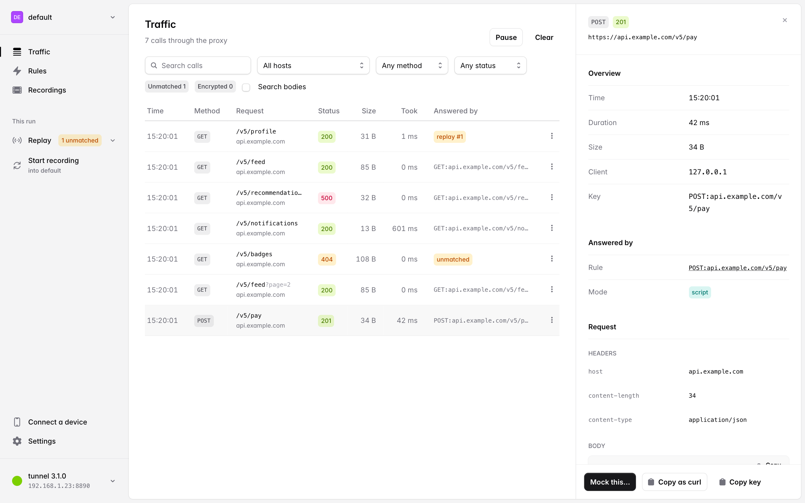

# tunnel

An HTTPS debugging proxy for app developers: an open-source alternative to
Charles and Proxyman, built for your AI coding agent to drive.

Point a phone, a simulator or any HTTP client at it to see every API call,
change what any endpoint answers, and record real answers to replay offline.

📖 [中文文档](README_zh-CN.md)

[](https://nodejs.org)
[](https://www.npmjs.com/package/tunnel-use)
[](LICENSE)

## Quick start

### With your coding agent

1. **Start tunnel:**

   ```bash
   npx tunnel-use serve --background     # Node 22.18+
   ```

2. **Add it to your agent:**

   ```bash
   claude mcp add --scope user tunnel -- npx -y tunnel-use mcp   # Claude Code
   codex mcp add tunnel -- npx -y tunnel-use mcp                 # Codex
   ```

   Other MCP clients, such as Cursor and Windsurf, take
   `{"mcpServers": {"tunnel": {"command": "npx", "args": ["-y", "tunnel-use", "mcp"]}}}`.

3. **Open a new agent session and ask.** No app is needed yet; the agent can
   send requests through tunnel itself:

   > Record https://jsonplaceholder.typicode.com/todos/1, replay it offline,
   > then make it return 503 and show me every call.

   Once your app goes through tunnel, as below, ask about its calls:

   > Make GET api.example.com/v5/feed return an empty list, and show me what
   > the app sent.

### On a phone

1. **Start tunnel**, unless it is already running:

   ```bash
   npm install -g tunnel-use
   tunnel serve --background
   ```

   It prints the address for the phone, such as
   `set the device's HTTP proxy to 192.168.1.23 port 8890`.

2. **Set the phone's proxy** to that address and port, on the same Wi-Fi:
   - iPhone: Settings > Wi-Fi > ⓘ next to the network > Configure Proxy > Manual
   - Android: Wi-Fi > the network > Advanced > Proxy > Manual

3. **Install the certificate:** open <http://ca.tunnel/> on the phone and follow
   the steps there. Two are easy to miss: on iPhone, switch tunnel on under
   Settings > General > About > Certificate Trust Settings; on Android 7 and
   later, the app's debug build has to trust user certificates
   (`<certificates src="user"/>`).

4. **Name the hosts to decrypt.** As with Charles's SSL Proxying list, nothing is
   decrypted until you add it:

   ```bash
   tunnel ssl add api.example.com
   ```

5. **Go.** Use the app and watch its calls at <http://127.0.0.1:8000/>. Change
   an answer, and it applies from the next request:

   ```bash
   tunnel set GET api.example.com/v5/feed -d '{"cards": []}'                # Map Local: answer with this JSON
   tunnel set GET api.example.com/v5/feed --target http://localhost:3000    # Map Remote: send it to your dev server
   tunnel set GET api.example.com/v5/feed --status 500 -d '{"error": "x"}'  # make it fail
   tunnel rm GET api.example.com/v5/feed                                    # back to the real server
   ```

   

When you are done, run `tunnel stop` and switch the phone's proxy off.
Simulators and emulators are covered in [Point a device at it](docs/devices.md).

## In your test code

Each test case sets its own answers and checks what the app called. A Node or
TypeScript suite starts tunnel inside its own process, with nothing to start
first and no port to agree on:

```ts
import assert from 'node:assert/strict'
import { startTunnel } from 'tunnel-use'

const tunnel = await startTunnel({ proxyHost: '127.0.0.1' })
try {
  await tunnel.setRule({ key: 'GET:api.example.test/v5/feed', mode: 'json', json_response: { cards: [] } })
  // ... drive the app through tunnel.proxyUrl; here one request stands in for it
  const answer = await tunnel.check('GET', 'http://api.example.test/v5/feed')
  assert.equal(answer.status, 200)
  const wait = await tunnel.waitForRequest({ key: 'GET:api.example.test/v5/feed', timeout: 5 })
  assert.equal(wait.timed_out, false)
} finally {
  await tunnel.stop()
}
```

A Swift or Kotlin test case running inside the app does the same over the
admin API.

## Why tunnel instead of Charles or Proxyman

For the everyday loop — proxy the phone, install the certificate, decrypt the
hosts you name, watch the calls, change an answer — tunnel works the way they
do. On top of that:

- **Your coding agent drives it.** The MCP server comes with tunnel, free, and
  every command also takes `--json` and exits with a code an agent can branch
  on; `tunnel agents` prints the guide for the installed version. Charles has no
  official MCP server, and Proxyman's needs a paid licence.
- **Record once, replay offline.** Real answers are recorded as JSON files you
  can commit next to your tests, and replay answers from them without the
  network. A call nothing answers is refused instead of reaching the real
  backend, and `tunnel requests --unmatched` lists it, so a CI run cannot pass
  by quietly calling the server. A JavaScript `handler(ctx)` can take a recorded
  answer and change one field of it.
- **Your tests drive it too.** A Node suite starts it in-process; each case
  sets its own answers, waits for the app's call instead of sleeping, and
  checks what arrived.
- **Free and open source**, under MIT, installed with npm.

## Documentation

| Page | What it covers |
| --- | --- |
| [How it works](docs/how-it-works.md) | the two ports, and how each request is answered |
| [Point a device at it](docs/devices.md) | phones, simulators and emulators; the CA certificate; which hosts are decrypted; the upstream proxy |
| [The panel](docs/panel.md) | the web panel at `127.0.0.1:8000` |
| [Rules](docs/rules.md) | rule keys; the json, script, passthrough and replay modes; sessions; faults and delays; scenario files |
| [The request log](docs/requests.md) | what the app called, and waiting for a call |
| [Record once, replay in CI](docs/record-replay.md) | recordings, sessions in CI, running in the background, several devices at once |
| [Calling tunnel from a test case](docs/in-app-tests.md) | Swift and Kotlin test cases over the admin API |
| [Using tunnel from TypeScript tests](docs/typescript-tests.md) | the `tunnel-use` library: `startTunnel()` and function rules |
| [Driving tunnel from a coding agent](docs/agents.md) | `tunnel agents` and the MCP server |
| [CLI reference](docs/cli.md) | every command |
| [Admin API v1](docs/admin-api.md) | the HTTP API the CLI, the panel and MCP are built on |
| [Where the files live](docs/files.md) | the config, state and data directories |
| [Testing and development](docs/development.md) | working on tunnel itself, and releasing it |

## License

MIT — see [LICENSE](LICENSE).
