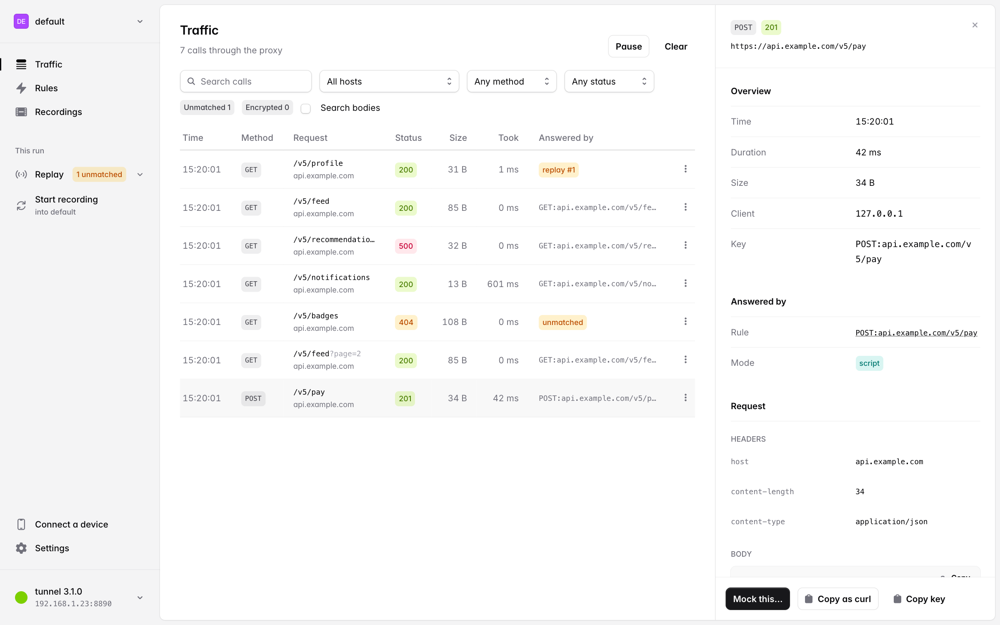

# tunnel

给 App 开发者的 HTTPS 调试代理：Charles、Proxyman 的开源替代，专为让 AI 编码
助手来驱动而设计。

把手机、模拟器或任何 HTTP 客户端指向它，就能看到每一次 API 调用、改任意接口的
返回，还能把真实返回录下来离线回放。

📖 [English](README.md)

[](https://nodejs.org)
[](https://www.npmjs.com/package/tunnel-use)
[](LICENSE)

## 快速上手

### 交给 AI 编码助手

1. **启动 tunnel：**

   ```bash
   npx tunnel-use serve --background     # 需要 Node 22.18+
   ```

2. **把它加给 agent：**

   ```bash
   claude mcp add --scope user tunnel -- npx -y tunnel-use mcp   # Claude Code
   codex mcp add tunnel -- npx -y tunnel-use mcp                 # Codex
   ```

   Cursor、Windsurf 等其他 MCP 客户端填
   `{"mcpServers": {"tunnel": {"command": "npx", "args": ["-y", "tunnel-use", "mcp"]}}}`。

3. **开一个新的 agent 会话，直接提要求。** 还不用接 app，agent 自己就能经 tunnel
   发请求：

   > 把 https://jsonplaceholder.typicode.com/todos/1 录下来，离线回放，再让它返回
   > 503，最后把每一次调用列给我看。

   等 app 照下一节接上 tunnel，就可以问 app 自己的调用：

   > 让 GET api.example.com/v5/feed 返回空列表，再告诉我 app 发了什么。

### 接上手机

1. **启动 tunnel**（已经起好就跳过）：

   ```bash
   npm install -g tunnel-use
   tunnel serve --background
   ```

   它会打印手机要填的地址，比如
   `set the device's HTTP proxy to 192.168.1.23 port 8890`。

2. **设置手机代理**：连同一个 Wi-Fi，手动代理填上面的地址和端口。
   - iPhone：设置 > 无线局域网 > 当前网络旁的 ⓘ > 配置代理 > 手动
   - Android：WLAN > 当前网络 > 高级 > 代理 > 手动

3. **安装证书**：手机浏览器打开 <http://ca.tunnel/>，照页面上的步骤装。有两步
   容易漏：iPhone 要到 设置 > 通用 > 关于本机 > 证书信任设置 里把 tunnel 打开；
   Android 7 起，app 的测试构建要信任用户证书（`<certificates src="user"/>`）。

4. **点名要解密的 host**：和 Charles 的 SSL Proxying 列表一样，没加进来的 host
   不解密。

   ```bash
   tunnel ssl add api.example.com
   ```

5. **开始用**：操作 app，在 <http://127.0.0.1:8000/> 看它的调用。改返回，下一个
   请求就生效：

   ```bash
   tunnel set GET api.example.com/v5/feed -d '{"cards": []}'                # Map Local：用这段 JSON 作答
   tunnel set GET api.example.com/v5/feed --target http://localhost:3000    # Map Remote：转给本地开发服务
   tunnel set GET api.example.com/v5/feed --status 500 -d '{"error": "x"}'  # 让它出错
   tunnel rm GET api.example.com/v5/feed                                    # 恢复走真实服务器
   ```

   

用完执行 `tunnel stop`，再把手机代理关掉。iOS 模拟器和 Android 模拟器怎么设，见
[让设备走它](docs/zh-CN/devices.md)。

## 在测试代码里用

每个用例在测试里自己设定返回、自己检查 app 调了什么。跑在 Node 或 TypeScript
里的测试套件直接在自己的进程里起 tunnel，不用先起服务，也不用约定端口：

```ts
import assert from 'node:assert/strict'
import { startTunnel } from 'tunnel-use'

const tunnel = await startTunnel({ proxyHost: '127.0.0.1' })
try {
  await tunnel.setRule({ key: 'GET:api.example.test/v5/feed', mode: 'json', json_response: { cards: [] } })
  // …经 tunnel.proxyUrl 驱动 app；这里用一个请求代替
  const answer = await tunnel.check('GET', 'http://api.example.test/v5/feed')
  assert.equal(answer.status, 200)
  const wait = await tunnel.waitForRequest({ key: 'GET:api.example.test/v5/feed', timeout: 5 })
  assert.equal(wait.timed_out, false)
} finally {
  await tunnel.stop()
}
```

跑在 app 里的 Swift、Kotlin 测试用例经管理 API 做同样的事。

## 为什么用 tunnel 而不是 Charles 或 Proxyman

日常那一套 —— 手机设代理、装证书、解密点名的 host、看请求、改返回 —— tunnel 和它们
用起来一样。除此之外：

- **AI 编码助手能驱动它。** MCP server 随 tunnel 一起装好，免费；每条命令也都能加
  `--json`，退出码可以拿来分支；`tunnel agents` 打印对应已装版本的使用指南。Charles
  没有官方的 MCP server，Proxyman 的 MCP 要付费授权才能用。
- **录一次，离线回放。** 真实返回录成 JSON 文件，可以和测试一起提交，回放时从这些文件
  作答、不碰网络。没有任何东西能答的调用直接拒绝，不会漏到真实后端，
  `tunnel requests --unmatched` 会把它们列出来，所以 CI 不会因为悄悄打到了真实服务器
  而蒙混过关。JavaScript 的 `handler(ctx)` 可以拿录下的返回改掉其中一个字段再答。
- **测试代码也能驱动它。** Node 测试套件在自己的进程里起它；每个用例自己设定返回，
  等 app 的调用到来而不是 sleep，再检查收到了什么。
- **免费、开源**，MIT 协议，`npm` 一装就能用。

## 文档

| 页面 | 讲什么 |
| --- | --- |
| [工作原理](docs/zh-CN/how-it-works.md) | 两个端口，每个请求怎么被作答 |
| [让设备走它](docs/zh-CN/devices.md) | 手机、模拟器怎么接进来；CA 证书；哪些 host 会被解密；上游代理 |
| [面板](docs/zh-CN/panel.md) | `127.0.0.1:8000` 上的网页面板 |
| [规则](docs/zh-CN/rules.md) | 规则 key；json、script、passthrough、replay 四种模式；session；故障与延迟；场景文件 |
| [请求日志](docs/zh-CN/requests.md) | app 调了什么，以及等待某个调用 |
| [录一次，在 CI 里回放](docs/zh-CN/record-replay.md) | 录制、CI 里的 session、后台运行、几台设备同时测 |
| [在测试用例里调用 tunnel](docs/zh-CN/in-app-tests.md) | Swift、Kotlin 测试用例经管理 API 调用 |
| [在 TypeScript 测试里用 tunnel](docs/zh-CN/typescript-tests.md) | `tunnel-use` 库：`startTunnel()` 和函数规则 |
| [用 AI 编码助手来驱动](docs/zh-CN/agents.md) | `tunnel agents` 和 MCP server |
| [命令行速查](docs/zh-CN/cli.md) | 所有命令 |
| [管理 API v1](docs/zh-CN/admin-api.md) | CLI、面板和 MCP 共用的 HTTP API |
| [文件放在哪里](docs/zh-CN/files.md) | config、state、data 三类目录 |
| [测试与开发](docs/zh-CN/development.md) | 开发 tunnel 本身，以及发版 |

## 许可证

MIT —— 见 [LICENSE](LICENSE)。
